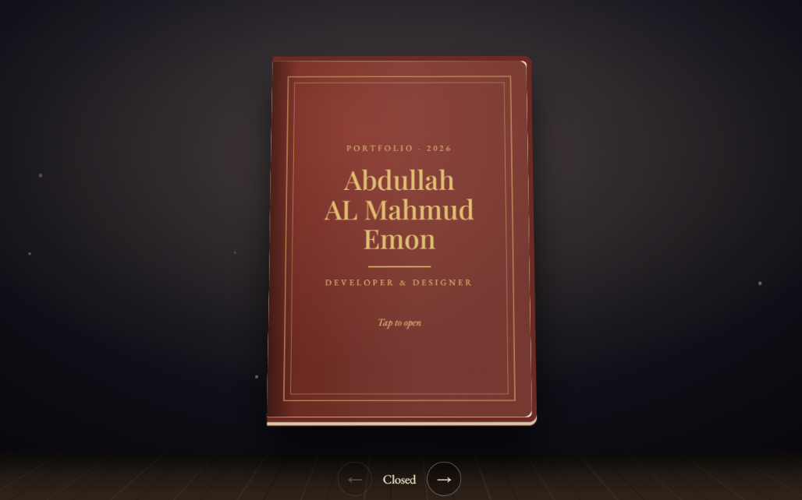
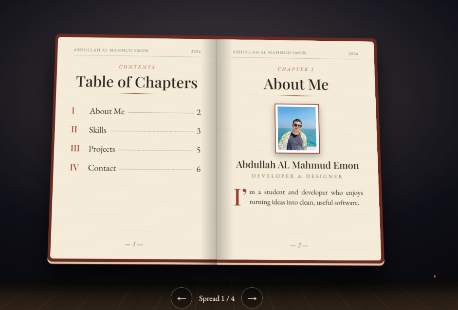

# Abdullah Emon's Portfolio Book

An interactive, book-style portfolio built with plain HTML, CSS, and JavaScript.

## Run locally

1. Download or clone this repository.
2. Keep `Portfolio Book.html` and `IMG_6684.jpg` together in the same folder.
3. Open `Portfolio Book.html` in a modern web browser.

For a local web server instead, open a terminal in the project folder and run:

```bash
python -m http.server 8000
```

Then visit <http://localhost:8000/Portfolio%20Book.html>.

There are no packages or build steps. Google Fonts are loaded online; the page
uses system serif fonts if they are unavailable.

## Using the book

- Click or tap the book, or use the arrow buttons to turn pages.
- Use the left and right arrow keys on a keyboard.
- On touch screens, swipe to turn pages.

## Screenshots




